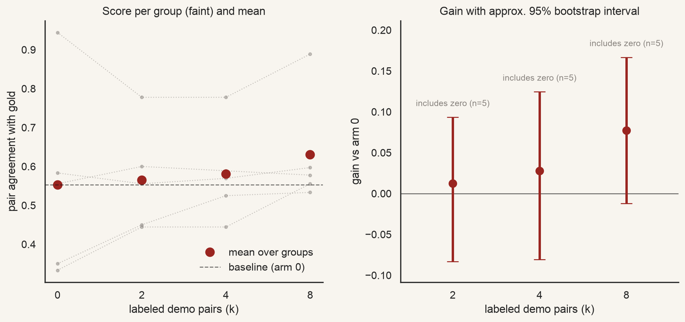

# sia-starter

Templates, a small analysis script and diagrams for **self-improving agents** (SIA): agents that get better from a signal, not from you editing the prompt.

**What you get:** for one agent, a written answer to "is it learning, or am I?", the signal it should learn from, and a plan for the examples you'll measure it on. **Who it's for:** anyone who **owns** an agent and can see its settings, logs and history: a coding harness, a chat assistant, a framework app, a DSPy or Ax program, a no-code workflow. **Time:** about 30–60 minutes for one agent. **Not for** auditing an agent someone else runs; that needs access and judgment the templates can't supply. If that's what you need, get in touch (siaalias-1.cardstock710@simplelogin.com · peleke.me · LinkedIn).

The loop has four steps: **act → signal → search → apply.** Three of them are slots you choose: the signal, the search, and the artifact the search changes. The learning check finds the slot that's missing; the signal card picks the signal.

## Use it
1. **Copy `templates/`** next to your agent (or into its repo).
2. **Find your platform** in [`docs/where-to-look.md`](docs/where-to-look.md): where its signals, changes and history live. Not listed? Use the closest row and mark answers "best-effort".
3. **Fill [`learning-check.md`](templates/learning-check.md)** → which loops exist, and whether each one is learning. Its "no"s feed step 4.
4. **Fill [`signal-card.md`](templates/signal-card.md)** → the signal, the search, the artifact, and a metric. The metric feeds step 5.
5. **Fill [`gold-set.md`](templates/gold-set.md)** → the examples the metric runs on, grouped and split.
6. **Later**, once you've run a baseline and a changed version on your test groups, **score them with the script** (below). It tells you the gain and how sure you can be.

`learning-check.md` has worked edge cases; the other two templates have one short example each. A fully filled set for one public agent (a framework app) is in [`examples/`](examples/).

## The script
Needs [uv](https://docs.astral.sh/uv/getting-started/installation/) (it installs Python 3.12+ for you).
```bash
uv sync                                          # install
uv run python notebooks/ea_dose_curve.py         # bundled example: writes out/dose-curve.png
uv run python notebooks/ea_dose_curve.py --cells your.csv --score-label "pass rate"   # your data: writes out/your.png
uv run python notebooks/ea_dose_curve.py --cells data/example-baseline.csv          # arm 0 only, 2+ reps: an A/A noise check, writes out/example-baseline.png
uv run --extra notebook jupytext --to ipynb notebooks/ea_dose_curve.py               # optional: as a notebook
```
**Your data**, one row per group × arm × run (see [`data/example-own.csv`](data/example-own.csv)):

| column | what it is | where it comes from |
|---|---|---|
| `group` | one independent unit: the group key from your gold set | the gold-set plan |
| `arm` | 0 = baseline; other numbers = changed versions | your experiment |
| `rep` | run number within that group and arm | your experiment |
| `score` | the metric for that run | your metric function |
| `excluded` (optional) | 1 to leave a row out, with your reason noted elsewhere | your run log |

In the output, `dropped` lists groups left out of a comparison because they have no row for that arm or for arm 0. `--out path.png` sets the figure path.

The bundled example is a real experiment from [our example pipeline](docs/example-pipeline.md): five groups, an inconclusive result, and a check that the numbers match the original analysis.



## Also here
- `scripts/check_n8n_export.py`: would an n8n export run as stored? (wiring, placeholders, credentials)
- `scripts/decode_dify.py`: a Dify export with escaped text made readable
- `diagrams/*.mmd`: the two loops as Mermaid (paste into GitHub or mermaid.live). Reference only; nothing to fill.
- `docs/example-pipeline.md`: the build the posts use as their running example.

## Agent versions (optional)
The templates work on their own. Agent versions of the checks live in [brunnr](https://github.com/Peleke/brunnr): [`learning-check`](https://github.com/Peleke/brunnr/tree/main/skills/learning-check), [`signal-card`](https://github.com/Peleke/brunnr/tree/main/skills/signal-card). A `gold-set` skill isn't published yet; use the template. They're standard `SKILL.md` folders: copy one into your agent's skills directory. Each skill's report ends with recommendations you can file as issues.

## Series and help
siaalias-1.cardstock710@simplelogin.com · peleke.me · LinkedIn

*Drafted with AI assistance, edited by me. The worked examples were filled by an AI agent and checked by a person.*
